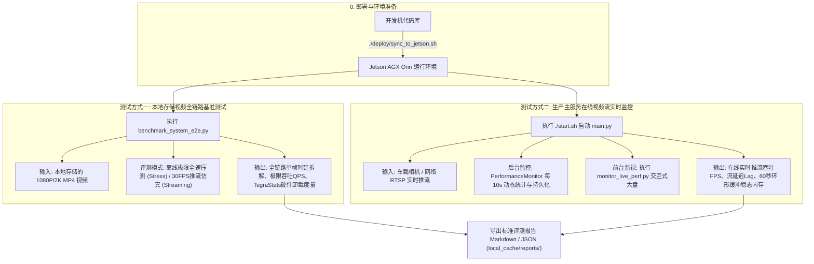

# 动车组受电弓网视频故障监测系统 - Jetson AGX Orin 平台性能评测操作手册

本文档专为在 **NVIDIA Jetson AGX Orin 边缘端硬件平台** 上开展系统性能评测与指标提取制定。涵盖系统的两种核心性能评测方式，帮助测试与算法人员快速获取权威的量化数据，直接支撑《系统评测报告》中关于**平均单帧/单图处理延迟**、**吞吐能力 (FPS / QPS)**、**GPU 显存 / 主机内存占用**以及 **Jetson 硬件加速器卸载率** 的编写。

---

## 一、 评测概述与两种测试方式对比



### 两种测试方式的核心区别与定位

| 评测维度 | 测试方式一：本地视频基准脚本 (`benchmark_system_e2e.py`) | 测试方式二：生产主服务视频流测试 (`start.sh` -> `main.py`) |
| :--- | :--- | :--- |
| **测试对象** | Jetson 本地 NVMe / eMMC / U盘存储的录像文件 (`.mp4`) | 真实 RTSP 视频流（车载相机或网络推流服务器） |
| **测试场景** | 实验室脱机压测、单机基准验收、算法上限摸底 | 真实在线推流、整车连调、长时间稳定性考核 |
| **核心考核点** | **全链路极限吞吐能力 (Peak QPS / FPS)**、各环节耗时分解瀑布、**TegraStats (NVDEC/VIC/功耗/温度)** | **在线推流吞吐 (FPS)**、**流延迟 (Stream Lag)**、队列积压深度、60s 环形缓冲填满后的**稳态物理内存** |
| **交互方式** | 命令行执行指定帧数后自动停止，输出完整报告 | 主服务持续长周期运行，前台工具随时动态监视，退出时自动固化总结 |

---

## 二、 评测前准备：代码同步与环境确认

### 1. 增量代码同步至 Jetson

在您的本地开发机终端中，运行同步脚本快速更新 Jetson 端代码（秒级增量传输）：

```bash
# 默认同步至 172.10.1.5 (hirain@172.10.1.5:/home/hirain/Desktop/gongwang_clean)
./deploy/sync_to_jetson.sh 172.10.1.5

# 若使用直连网线或 Type-C (192.168.55.1)，可直接指定 IP:
# ./deploy/sync_to_jetson.sh 192.168.55.1
```

### 2. 登录 Jetson 并检查环境

通过 SSH 登录到 Jetson 设备：

```bash
ssh hirain@172.10.1.5
cd /home/hirain/Desktop/gongwang_clean

# 激活 Python 运行环境 (根据板卡配置选择对应的虚拟环境或容器)
source /home/ibd/anaconda3/bin/activate yolo11   # 或 source /home/hirain/arch_env/bin/activate
```

### 3. 确认 TensorRT 引擎就绪

检查针对 Jetson AGX Orin 架构 (SM 8.7) 编译的 TensorRT 引擎是否存在：
```bash
ls -lh models/*.engine
```
若缺少 `.engine` 文件，执行一次快速导出编译（FP16 模式）：
```bash
python3 tools/export_tensorrt.py --model all --precision fp16
```

---

## 三、 测试方式一：使用脚本测试 Jetson 端本地存储的视频

> **适用场景**：提取系统的极限处理能力、子阶段耗时百分比以及专用硬件加速器（NVDEC/VIC）卸载表现。

### 1. 执行基准评测命令

在 Jetson 终端中执行 [`tools/benchmark_system_e2e.py`](file:///mnt/T4/jyb/gongwang_clean/tools/benchmark_system_e2e.py)：

```bash
# 推荐指令：综合全套模式评测 (包含 200 帧离线极限压测 + 30 FPS 在线推流仿真)
python3 tools/benchmark_system_e2e.py \
    --video /home/hirain/Desktop/gongwang_clean/local_cache/test.mp4 \
    --frames 200 \
    --mode all

# 参数详解:
#   --video   : 指定测试视频文件路径 (若不填则自动在常用目录查找 .mp4 文件)
#   --frames  : 评测帧数，推荐 150 ~ 300 帧 (覆盖多个 1.0s 分频调度周期)
#   --mode    : 
#               • stress    - 离线极限压测 (无等待，测算系统全链路最大 QPS / FPS)
#               • streaming - 在线推流仿真 (按 30FPS 严格节奏喂帧，测算流积压与稳态)
#               • all       - 综合模式 (依次执行上述两种测试并合并生成大盘)
#   --report  : 报告导出路径，默认保存在 local_cache/system_e2e_benchmark_report.md
```

### 2. 测试过程说明

执行期间，工具将自动完成以下流程：
1. **流水线 Warmup**：预热 5 帧，激活 CUDA 上下文与 TensorRT Execution Context；
2. **启动 TegraStats 采集**：后台以 100ms 间隔自动采样硬件传感器；
3. **全链路逐帧执行**：覆盖视频读取解码、黑板调度、6 类故障插件推理、融合互斥仲裁、HUD 渲染与环形缓冲存帧；
4. **统计汇总与报告导出**：计算各项指标分布并写入 Markdown 与 JSON 文件。

### 3. 查看评测报告

评测完成后，直接查看生成的工业级 Markdown 报告：
```bash
cat local_cache/system_e2e_benchmark_report.md
```

配套的数据归档 JSON 文件保存在 `local_cache/system_e2e_benchmark_report.json`，方便程序解析或自动化流水线集成。

---

## 四、 测试方式二：`start.sh` 启动 `main.py` 在系统处理视频流中测试性能

> **适用场景**：整套系统在真实车载环境或模拟推流环境下的在线运行评测，度量长周期推流下的吞吐稳定性、流延迟积压（Stream Lag）以及 60 秒环形缓冲满载后的常驻物理内存。

### 1. 确认流地址与监控配置

检查 [`config/config_prod.yaml`](file:///mnt/T4/jyb/gongwang_clean/config/config_prod.yaml)：
```yaml
video_stream_config:
  fps: 25.0
  streams:
    - rtsp_url: "rtsp://172.10.1.126/live/test"   # 确认相机或推流服务地址
      camera_id: 0
      car_number: 6

log_config:
  perf_monitor:
    enabled: true              # 开启性能监控
    report_interval_sec: 10.0  # 每 10 秒输出一次大盘
    auto_export_report: true   # 自动生成/刷新 Markdown 报告
    report_dir: "local_cache/reports"
```

### 2. 启动生产监测主服务 (终端 A)

在 Jetson 终端 A 执行：
```bash
./start.sh config/config_prod.yaml
```
主程序将拉取视频流并启动全流程处理流水线。每隔 10 秒在终端和日志中打印 `[PerfMonitor]` 周期统计。

### 3. 动态监测性能指标 (终端 B)

保持终端 A 运行，新打开一个 SSH 终端连接至 Jetson，选择以下任一方式查看实时性能：

#### 方式 A：运行交互式动态监视终端 (强烈推荐)
```bash
python3 tools/monitor_live_perf.py
```
控制台将呈现动态刷新的工业仪表盘（每 2 秒刷新一次）：
* 当前实时有效处理帧率 (FPS) 及是否积压提示；
* 全链路单帧时延 (Mean / P50 / P95 / Max)；
* 33.3ms 单帧时间预算占用率进度条；
* GPU 显存 (Allocated / Peak) 与主机物理内存 (RSS / Peak)；
* 各检测器插件单体推理耗时明细。
> 按 `Ctrl+C` 即可退出监视终端，**后台的主程序不会受到任何影响**。

#### 方式 B：随时直接查看自动刷新的 Markdown 报告
主程序每 10 秒会自动更新一次当前阶段的评测大盘：
```bash
cat local_cache/reports/live_perf_report_perf_monitor_CAR6_CAM0.md
```

#### 方式 C：实时跟踪日志打点
```bash
tail -f local_cache/logs/latest.log | grep -A 10 "PerfMonitor"
```

### 4. 结束测试并固化全生命周期报告

当测试时长满足要求（建议运行 5~10 分钟以覆盖环形缓冲前 60s 存满稳态）后：
在终端 A 按下 `Ctrl+C`（或在终端 B 执行 `./close.sh`）。

主程序将平稳收敛退出，并在退出时自动将全生命周期综合大盘保存至：
```bash
cat local_cache/reports/final_perf_report_perf_monitor_CAR6_CAM0.md
```

---

## 五、 《系统评测报告》数据填报对照指引

编写《系统评测报告》时，请直接参考下表从生成的报告中提取标准量化指标：

| 评测报告标准章节 | 对应指标名称 | 推荐获取方式 | 报告/文件中的字段位置 | 典型合格标准 |
| :--- | :--- | :--- | :--- | :--- |
| **处理时延** | **平均单帧/单图处理延迟** | 方式一 / 方式二 | `全链路端到端总延迟 (Total E2E) -> Mean` | ≤ 33.3 ms (30 FPS) |
| **时延分布** | **P50 中位数 / P95 尾部时延** | 方式一 / 方式二 | `全链路端到端总延迟 (Total E2E) -> P50 / P95` | P95 ≤ 33.3 ms |
| **时延拆解** | **取流解码耗时** | 方式一 / 方式二 | `取流与视频解码 (Decode) -> Mean` | 3 ~ 6 ms (NVDEC硬解) |
| **时延拆解** | **算法调度与模型推理耗时** | 方式一 / 方式二 | `分频调度与模型推理 (Inference) -> Mean` | 15 ~ 25 ms |
| **时延拆解** | **融合仲裁与 HUD 渲染耗时** | 方式一 / 方式二 | `跨模块融合 (Fusion) + HUD 渲染 (HUD) -> Mean` | < 4 ms |
| **吞吐能力** | **在线推流吞吐 (FPS)** | 方式二 (实车/推流) | `系统吞吐能力 (FPS) -> 实测数值` | ≥ 25.0 FPS (无发散性积压) |
| **吞吐能力** | **极限处理吞吐 (QPS / FPS)** | 方式一 (离线全速) | `全系统全链路极限吞吐 -> 实测数值` | ≥ 30.0 FPS |
| **实时性** | **流延迟 (Stream Lag)** | 方式二 (实车/推流) | `流延迟 (Stream Lag) -> 实测数值` | ≤ 0.1 s |
| **资源占用** | **GPU 显存占用 (VRAM)** | 方式一 / 方式二 | `GPU 显存 (Allocated / Peak VRAM)` | 稳态 ~350MB / 峰值 < 1GB |
| **资源占用** | **系统物理内存占用 (Host RAM)**| 方式二 (运行 >60s) | `系统物理内存 (Host RAM RSS)` | 稳态 ~1.7GB (含60s环形缓冲) |
| **硬件卸载** | **Jetson NVDEC 硬件解码利用率**| 方式一 (Jetson实机) | `Jetson 硬件状态 -> NVDEC 引擎利用率` | 15% ~ 35% |
| **整机功耗** | **Jetson 运行功耗与温度** | 方式一 (Jetson实机) | `Jetson 硬件状态 -> 整机瞬时功耗 (W) / 结温 (°C)` | 功耗 15~35W / 温度 < 65°C |

---

## 六、 常见问题排查与优化建议 (Troubleshooting)

### 1. NVDEC 硬件解码未生效 (显示 CPU 软解)
* **现象**：解码耗时高达 15~25ms，TegraStats 中 `NVDEC` 利用率为 0%。
* **排查**：在 `config/config_prod.yaml` 中确认视频源拉流配置：
  ```yaml
  video_stream_config:
    streams:
      - rtsp_url: "rtsp://..."
        decoder_backend: "gstreamer_nvdec"  # 确保显式指定使用 NVDEC 硬解
        codec_type: "auto"
  ```

### 2. 环形缓冲内存占用疑问
* **现象**：主服务运行 1 分钟后，物理内存从启动时的 400MB 上升到 1.6GB~1.8GB。
* **原因**：这是系统设计的正常行为。系统内置了 `RingFrameBuffer`，为了应对突发故障前后 60 秒的取证回溯，在内存中缓存了 60 秒的高清 JPEG 帧（约 1500~1800 帧）。内存达到 60 秒窗口后将进入恒定稳态，不会无限泄漏。

### 3. TegraStats 权限问题
* 若运行 `benchmark_system_e2e.py` 时提示无法读取硬件状态，确认当前用户对 `/usr/bin/tegrastats` 具有执行权限：
  ```bash
  sudo chmod +x /usr/bin/tegrastats
  ```
