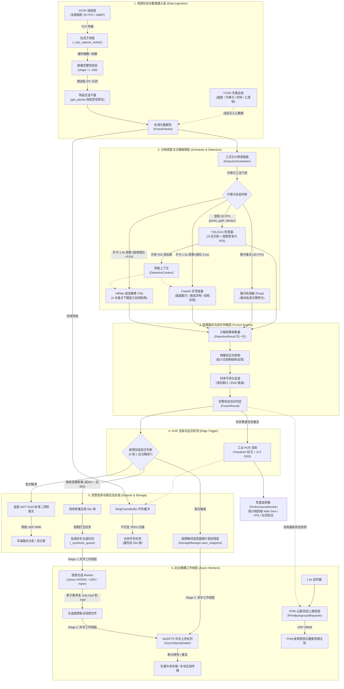

# 动车组受电弓网视频故障监测系统 - 完整端到端链路与耗时把控分析

本文档详细记录了动车组受电弓网视频故障监测系统从 RTSP 视频流摄入到最终告警上报、视频录像落盘以及 PHM 状态传输的**完整端到端链路架构图（Mermaid 格式，已针对 Typora 完美兼容）**，并对全链路各个阶段的**时间预算、耗时瓶颈与性能把控策略**进行定量分析。

---

## 一、 系统端到端执行链路图 (Mermaid)

---

## 二、 全链路各阶段耗时定量分析与把控要点

为了保证 **30 FPS 实时推流不掉帧**，每帧端到端总时间预算必须严格控制在 **33.3 ms** 以内。

| 链路阶段 | 模块与文件 | 典型耗时区间 | 耗时瓶颈与潜在卡点 | 系统现有把控与优化手段 |
| :--- | :--- | :--- | :--- | :--- |
| **1. 取流与解码** | `core/ingestion/stream_reader.py` | **3 ~ 20 ms** | • FFmpeg 软解在 Jetson ARM 核心上 CPU 占用高达 15%~30% • 网络抖动时 C 库 `cap.read()` 挂起死锁 | • 独立子进程原生隔离 + 30s 硬看门狗自愈 • `get_packet()` 具备零延迟汲干机制，持续清空积压旧帧 • 建议可选启用 GStreamer NVDEC 硬解压至 ~3ms |
| **2. TCMS 信号注入** | `ai_detector.py` | **< 0.1 ms** | • 字符串转换、时钟对齐解析开销 | • 纯内存字典读取与位移计算，忽略不计 |
| **3. YOLO 逐帧检测** | `core/detectors/spark_detector.py` `core/detectors/float_detector.py` | **8 ~ 18 ms** *(核心大头)* | • 逐帧 30 FPS 执行，直接决定系统基础帧率与吞吐下限 | • TensorRT FP16 / INT8 推理加速 • 黑板共享机制：YOLO 提取的受电弓框直接写入 Context，供后续插件复用 |
| **4. FastAD 异常度量** | `core/detectors/dirt_detector.py` `core/detectors/struct_detector.py` `core/detectors/foreign_detector.py` | **30 ~ 65 ms** *(重计算任务)* | • 特征提取与 PatchCore/马氏距离检索量大，若逐帧运行会导致严重卡顿 | • **分频降采样调度**：降为 1.0s 周期执行 • **工况门控**：仅在升弓受流态（`raised_only`）运行，降弓静默 |
| **5. HRNet 姿态解算** | `core/detectors/tilt_detector.py` | **20 ~ 45 ms** *(重计算任务)* | • 4 关键点高分辨率热图回归计算耗时较高 | • **错峰调度（Staggered Phase）**：同为 1.0s 周期，但强制设置 `phase_offset_sec: 0.5s`，与 FastAD 在时域错开 500ms，**彻底避免双模型同帧叠加产生 >100ms 尖峰** |
| **6. 结果融合与仲裁** | `core/fusion/fusion_engine.py` | **< 0.5 ms** | • 逻辑分支与多状态机更新 | • 纯内存互斥矩阵查找与滑动窗口计数，无锁快速返回 |
| **7. 工业 HUD 渲染** | `core/output/visualizer.py` | **1 ~ 4 ms** | • 1080P 图像画框、中文字符与 3+2 OSD 绘制开销 | • **按需渲染**：正常无告警状态下不执行渲染，仅在检出异常或录像合成激活时调用 |
| **8. 告警落盘与上报** | `core/output/udp_sender.py` `core/output/storage_manager.py` | **< 1 ms (主线程)** *(快照落盘约 8ms)* | • 本地磁盘 I/O（`imwrite`）和网络 Socket 偶发卡顿 | • **边沿触发机制**：仅在故障状态从 `0 到 1` 的瞬间触发抓拍与发射，持续告警期零重复 I/O • UDP 报文非阻塞发射 |
| **9. 环形缓冲存帧** | `core/ingestion/ring_buffer.py` | **2 ~ 4 ms** | • 每帧 JPEG 编码内存分配与复制开销 | • 统一转换为只读不可变 `bytes` 隔离；双缓冲只写内存 |
| **10. 前后 60s 录像合成** | `core/ingestion/ring_buffer.py` | **300 ~ 1500 ms** *(巨型 I/O)* | • 约 3600 张 JPEG 解码并重编码为 MP4 视频，耗时达秒级 | • **Stage 1 异步解耦流水线**：主线程仅将任务投递至后台队列（耗时 `< 0.1ms`），由独立 Worker 线程调用 NVENC 硬编合成，设置最大队列深度（maxsize=5）防止 OOM |
| **11. 车地 FTP/NAS 上传** | `core/output/async_uploader.py` | **1 ~ 10 秒** *(长延时网络 I/O)* | • 车地无线网或车载局域网拥塞、丢包或超时 | • **Stage 2 异步上传解耦流水线**：合成完成自动回调投递，网络重试和传输由独立 Worker 承载，对算法主循环零干扰 |
| **12. PHM 周期心跳** | `phm_service.py` | **< 0.1 ms (主线程)** | • 39008 端口周期汇报 | • 独立后台线程每 1000ms 异步拉取算法状态快照并打包发射 |

---

## 三、 保证 30 FPS 实时性与高可用的三大关键架构设计

### 1. 削峰填谷：错峰调度机制 (Staggered Phases)
- **平稳帧（仅 YOLO）**：单帧耗时稳定在 **15~22ms**（< 33.3ms，吞吐充足）。
- **周期复合帧**：若 FastAD（~45ms）与 HRNet（~35ms）在同一时刻触发，叠加单帧耗时将达 **100ms+**（导致丢弃 3 帧）。
- **工程解法**：调度器通过理论时间槽对齐，强制 FastAD 在 `0.0s, 1.0s, 2.0s...` 触发，HRNet 在 `0.5s, 1.5s, 2.5s...` 触发，将算力尖峰平滑分散。

### 2. 防延迟发散：零延迟汲干 (Zero-Latency Drain)
- 无论网络端或前序偶发耗时毛刺如何波动，消费端 `get_packet()` 每次获取帧后，均会以 `get_nowait()` 排空所有历史积压帧。
- 确保 AI 检测器每轮处理的永远是**网络到达的最新鲜一帧**，彻底消除延时累积效应。

### 3. I/O 隔离：两级异步流水线 (Two-Stage Decoupled Pipeline)
- **Stage 1 (视频合成 Worker)**：故障后 60 秒到期时，主线程投递至队列后立即返回（耗时 < 0.1ms），后台线程从内存无锁提取快照进行 NVENC 硬件硬编。
- **Stage 2 (网络上传 Worker)**：视频写盘完成后通过回调直接移交上传队列，主循环完全感知不到数百兆网络大文件传输的 I/O 阻塞。
